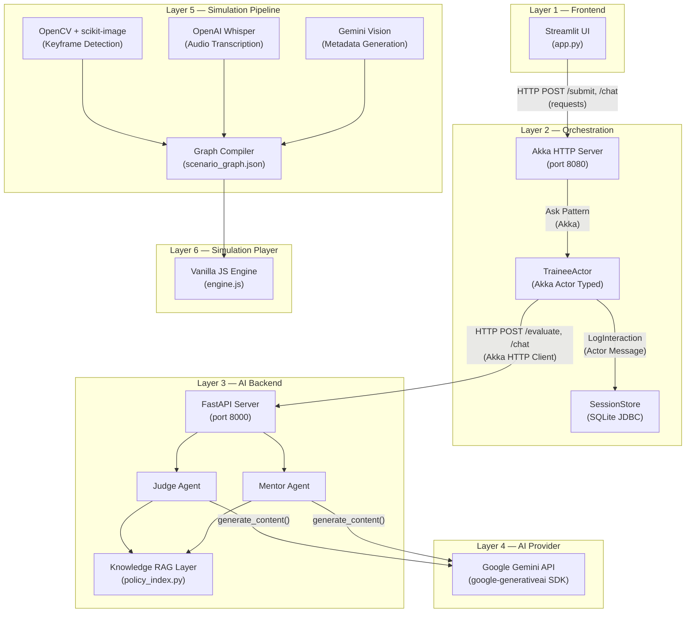
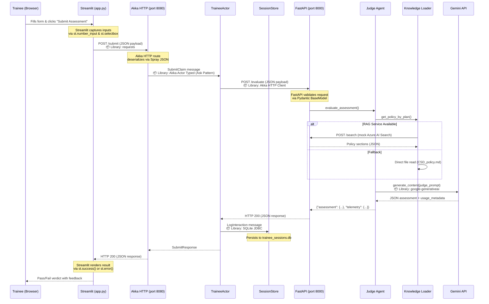

# SmartPath — Comprehensive Library & Dependency Documentation

> **Project**: SmartPath POC — US Claims Adjudication Workstation  
> **Version**: 1.0.0  
> **Last Updated**: September 2026  
> **Audience**: Developers, Architects, Reviewers, and Stakeholders

---

## Table of Contents

1. [Executive Overview](#1-executive-overview)
2. [Architecture & Library Mapping](#2-architecture--library-mapping)
3. [Python Libraries](#3-python-libraries)
   - 3.1 [Streamlit](#31-streamlit)
   - 3.2 [FastAPI](#32-fastapi)
   - 3.3 [Pydantic](#33-pydantic)
   - 3.4 [Uvicorn](#34-uvicorn)
   - 3.5 [Google Generative AI SDK (`google-generativeai`)](#35-google-generative-ai-sdk-google-generativeai)
   - 3.6 [Requests](#36-requests)
   - 3.7 [OpenCV (`opencv-python`)](#37-opencv-opencv-python)
   - 3.8 [scikit-image](#38-scikit-image)
   - 3.9 [OpenAI Whisper](#39-openai-whisper)
4. [Scala / JVM Libraries](#4-scala--jvm-libraries)
   - 4.1 [Akka Actor Typed](#41-akka-actor-typed)
   - 4.2 [Akka HTTP](#42-akka-http)
   - 4.3 [Akka HTTP Spray JSON](#43-akka-http-spray-json)
   - 4.4 [Akka Stream](#44-akka-stream)
   - 4.5 [Akka PKI](#45-akka-pki)
   - 4.6 [SQLite JDBC](#46-sqlite-jdbc)
   - 4.7 [Logback Classic](#47-logback-classic)
5. [Frontend & System Tooling](#5-frontend--system-tooling)
   - 5.1 [Google Fonts (Inter)](#51-google-fonts-inter)
   - 5.2 [Gemini REST API (Direct Fetch)](#52-gemini-rest-api-direct-fetch)
   - 5.3 [FFmpeg](#53-ffmpeg)
6. [End-to-End Request Flow](#6-end-to-end-request-flow)
7. [Consolidated Dependency Summary](#7-consolidated-dependency-summary)

---

## 1. Executive Overview

SmartPath is a multi-language, multi-tier proof-of-concept that simulates a US health insurance claims adjudication workstation. It combines:

- A **Python-based frontend** for the trainee-facing workstation UI
- A **Scala/Akka-based orchestration layer** for message-driven request routing and session persistence
- A **Python-based AI backend** that connects to Google Gemini LLMs for real-time evaluation and mentorship
- A **Video processing pipeline** that converts screen recordings into interactive training simulations
- A **Vanilla JS/HTML webview player** that runs the compiled simulations in the browser

Each layer leverages purpose-specific libraries chosen for their strengths in that domain. This document explains every external dependency — **what it is**, **why it was needed**, **how it was used**, and **what was achieved**.

---

## 2. Architecture & Library Mapping



### Library-to-Layer Mapping

| Layer | Purpose | Libraries Used |
|-------|---------|---------------|
| **Frontend** | Trainee workstation UI | Streamlit, Requests |
| **Orchestration** | Message routing, session DB | Akka Actor Typed, Akka HTTP, Spray JSON, Akka Stream, Akka PKI, SQLite JDBC, Logback |
| **AI Backend** | LLM-powered agents + RAG | FastAPI, Pydantic, Uvicorn, google-generativeai |
| **Simulation Pipeline** | Video → interactive sim | OpenCV, scikit-image, Whisper, google-generativeai, FFmpeg |
| **Simulation Player** | Browser-based sim runner | Google Fonts, Gemini REST API (direct fetch) |

---

## 3. Python Libraries

---

### 3.1 Streamlit

| Property | Detail |
|----------|--------|
| **Package** | `streamlit` |
| **Website** | [streamlit.io](https://streamlit.io) |
| **License** | Apache 2.0 |
| **Used In** | [`app.py`](file:///c:/SmartPath/app.py) |

#### Requirement

SmartPath needed a **rapid-prototyping UI framework** that could simulate a dense, legacy-style enterprise workstation — complete with multi-column layouts, expanders, data tables, form inputs, chat interfaces, and real-time session state management — without requiring a full frontend engineering stack (React, Vue, etc.).

#### How It Was Used

Streamlit serves as the **entire frontend layer** of the application. Key usage patterns include:

- **Page configuration & layout**: `st.set_page_config()` sets the wide layout; `st.columns()` and `st.tabs()` create the two-column workstation with a Telemetry tab.
- **Form widgets**: `st.text_input()` renders 24+ disabled fields populated from scenario JSON to mimic a read-only legacy claims form. `st.number_input()` and `st.selectbox()` capture trainee answers.
- **Session state**: `st.session_state` persists chat history, telemetry logs, the current scenario index, and the Akka session ID across Streamlit reruns.
- **Chat interface**: `st.chat_message()` and `st.chat_input()` power the Mentor Agent's interactive help sidebar.
- **Dynamic content**: `st.spinner()` provides loading feedback during LLM calls; `st.success()` / `st.error()` render Judge Agent verdicts with color coding.
- **Custom CSS injection**: `st.markdown(unsafe_allow_html=True)` injects custom CSS to tighten padding and reduce font sizes, giving the UI a dense enterprise feel.
- **Sidebar**: `st.sidebar` hosts API key input, model selection, queue navigation, and a mock terminal session panel.

```python
# Example: Chat interface for the Mentor Agent (app.py, lines 276-314)
for role, message in st.session_state.chat_history:
    with st.chat_message(role):
        st.markdown(message)

user_question = st.chat_input("Ask for help with the claim policy...")
```

#### What Was Achieved

Streamlit enabled the team to build a **fully functional, multi-panel enterprise workstation UI in a single 342-line Python file** — with no HTML templates, no build step, no JS bundling. The result is a UI that authentically mimics a legacy GLH Enterprise claims engine, complete with:
- A 24-field claims form auto-populated from scenario data
- Real-time Judge Agent grading with pass/fail feedback
- An interactive Mentor Agent chat grounded in policy rules
- A backend telemetry dashboard showing token usage and retrieval sources
- Queue navigation to cycle through multiple claim scenarios

---

### 3.2 FastAPI

| Property | Detail |
|----------|--------|
| **Package** | `fastapi` |
| **Website** | [fastapi.tiangolo.com](https://fastapi.tiangolo.com) |
| **License** | MIT |
| **Used In** | [`ai_service.py`](file:///c:/SmartPath/ai_service.py) |

#### Requirement

The AI agents (Judge and Mentor) needed to be exposed as **HTTP microservice endpoints** so that the Akka orchestrator could call them over the network — cleanly decoupling the Scala orchestration layer from the Python AI logic.

#### How It Was Used

FastAPI is the **web framework** powering the AI backend server on port 8000. It provides:

- **REST endpoint definitions**: Three endpoints are defined — `POST /evaluate` (Judge Agent), `POST /chat` (Mentor Agent), and `POST /search` (mock Azure AI Search).
- **Pydantic request models**: `ClaimRequest`, `ChatRequest`, and `SearchRequest` classes validate and deserialize incoming JSON payloads.
- **Startup event**: `@app.on_event("startup")` triggers `build_index()` to pre-build the in-memory policy index at server boot, ensuring the RAG layer is warm before any requests arrive.
- **Policy retrieval endpoint**: `GET /policy/{plan_class}` returns the full policy document for the Streamlit sidebar's policy viewer.

```python
# Example: Judge Agent endpoint (ai_service.py, lines 35-45)
@app.post("/evaluate")
def evaluate_claim(request: ClaimRequest):
    genai.configure(api_key=request.api_key)
    model = genai.GenerativeModel(request.model or DEFAULT_MODEL)
    result = evaluate_assessment(model, request.eligible_amount,
                                 request.oop_amount, request.decision,
                                 request.plan_class, request.scenario)
    return {"success": True, "data": result["assessment"], "telemetry": result["telemetry"]}
```

#### What Was Achieved

FastAPI enabled the project to stand up a **fully typed, auto-documented AI microservice** that:
- Cleanly separates AI logic from orchestration
- Validates all incoming payloads at the framework level
- Serves as the "brain" of the system, hosting both the Judge and Mentor agents
- Provides a mock Azure AI Search endpoint (`/search`) that simulates enterprise RAG infrastructure
- Starts with a warm knowledge index on boot, eliminating cold-start latency for the first request

---

### 3.3 Pydantic

| Property | Detail |
|----------|--------|
| **Package** | `pydantic` |
| **Website** | [docs.pydantic.dev](https://docs.pydantic.dev) |
| **License** | MIT |
| **Used In** | [`ai_service.py`](file:///c:/SmartPath/ai_service.py) |

#### Requirement

Incoming JSON payloads from the Akka orchestrator needed **automatic validation, type coercion, and deserialization** — ensuring that malformed requests (e.g., a missing `api_key` or a string where a float is expected) are rejected before reaching the AI agent logic.

#### How It Was Used

Pydantic is used via FastAPI's native integration. Three `BaseModel` subclasses define the request schemas:

- **`ClaimRequest`** — Validates Judge Agent submissions: `api_key`, `plan_class`, `eligible_amount` (float), `oop_amount` (float), `decision`, `model` (Optional), `scenario` (dict).
- **`ChatRequest`** — Validates Mentor Agent chat messages: `api_key`, `plan_class`, `message`, `model` (Optional), `scenario` (dict).
- **`SearchRequest`** — Validates RAG search queries: `plan_class`, `query`, `top_k` (int, default 2).

```python
# Example: Pydantic model with optional fields and defaults (ai_service.py, lines 19-26)
class ClaimRequest(BaseModel):
    api_key: str
    plan_class: str
    eligible_amount: float
    oop_amount: float
    decision: str
    model: Optional[str] = DEFAULT_MODEL
    scenario: dict
```

#### What Was Achieved

Pydantic eliminated an entire class of **runtime errors** from the AI backend. Any request with a missing field, wrong type, or unexpected structure is automatically rejected with a clear 422 Validation Error — before it ever reaches the Gemini API. This made the pipeline significantly more robust during development, especially when debugging payloads flowing across the Streamlit → Akka → FastAPI boundary.

---

### 3.4 Uvicorn

| Property | Detail |
|----------|--------|
| **Package** | `uvicorn` |
| **Website** | [uvicorn.org](https://www.uvicorn.org) |
| **License** | BSD 3-Clause |
| **Used In** | Runtime server (see [README.md](file:///c:/SmartPath/README.md)) |

#### Requirement

FastAPI is an ASGI framework and requires a **compatible ASGI server** to run. The project needed a lightweight, production-quality server to serve the AI backend on port 8000.

#### How It Was Used

Uvicorn is the ASGI server that hosts the FastAPI application. It is invoked from the command line:

```bash
uvicorn ai_service:app --port 8000 --reload
```

- `ai_service:app` — Points to the FastAPI `app` instance in `ai_service.py`
- `--port 8000` — Serves on the port that the Akka orchestrator expects
- `--reload` — Enables hot-reload during development (auto-restarts on file changes)

#### What Was Achieved

Uvicorn provided a **zero-configuration, high-performance ASGI server** that:
- Runs the FastAPI app with async support for handling concurrent LLM calls
- Supports hot-reload for rapid iteration during development
- Acts as the "invisible infrastructure" that makes the Python AI backend accessible over HTTP

---

### 3.5 Google Generative AI SDK (`google-generativeai`)

| Property | Detail |
|----------|--------|
| **Package** | `google-generativeai` (version ≥ 0.8.0) |
| **Website** | [ai.google.dev](https://ai.google.dev) |
| **License** | Apache 2.0 |
| **Used In** | [`ai_service.py`](file:///c:/SmartPath/ai_service.py), [`judge_agent.py`](file:///c:/SmartPath/agents/judge_agent.py), [`mentor_agent.py`](file:///c:/SmartPath/agents/mentor_agent.py), [`app.py`](file:///c:/SmartPath/app.py), [`metadata_generator.py`](file:///c:/SmartPath/simulation_module/pipeline/metadata_generator.py) |

#### Requirement

SmartPath's core intelligence — claim evaluation, trainee mentorship, and automated metadata generation — all require **Large Language Model inference**. The project standardized on Google's Gemini family of models and needed the official Python SDK to interact with the Gemini API.

#### How It Was Used

This is the **most widely used library** in the project, appearing across four components:

**1. Frontend (`app.py`)** — Used for API key validation and model discovery:
```python
genai.configure(api_key=api_key)
available_models = [m.name.replace("models/", "")
                    for m in genai.list_models()
                    if "generateContent" in m.supported_generation_methods]
```

**2. Judge Agent (`judge_agent.py`)** — Generates structured JSON assessments:
```python
response = model.generate_content(judge_prompt, request_options={"timeout": 15})
# Parses the LLM output as JSON: {"Status": "Pass/Fail", "Score": 100/0, "Feedback": "..."}
```

**3. Mentor Agent (`mentor_agent.py`)** — Generates conversational policy guidance:
```python
response = model.generate_content(mentor_prompt, request_options={"timeout": 15})
# Returns natural language text grounded in policy rules
```

**4. Metadata Generator (`metadata_generator.py`)** — Multimodal vision + text generation:
```python
img_file = genai.upload_file(kf["path"])  # Upload keyframe image
response = model.generate_content(
    [img_file, prompt],  # Multimodal: image + text prompt
    generation_config=genai.GenerationConfig(
        response_mime_type="application/json",  # Force JSON output
        temperature=0.2
    )
)
genai.delete_file(img_file.name)  # Cleanup uploaded file
```

**5. Token telemetry** — Both agents extract usage metadata for the telemetry dashboard:
```python
usage = response.usage_metadata
telemetry = {
    "prompt_tokens": usage.prompt_token_count,
    "completion_tokens": usage.candidates_token_count,
    "total_tokens": usage.total_token_count,
}
```

#### What Was Achieved

The Google Generative AI SDK is the **intellectual engine** of SmartPath. It enabled:
- **Automated claim grading**: The Judge Agent evaluates trainee submissions against policy rules and returns pass/fail verdicts with explanatory feedback — in under 3 seconds
- **Policy-grounded mentorship**: The Mentor Agent answers trainee questions using only the active plan's rules, refusing to hallucinate or reveal direct answers
- **Multimodal simulation authoring**: The pipeline uploads keyframe screenshots to Gemini Vision, which analyzes each frame and generates structured JSON metadata describing UI elements, action types, and instructional hints
- **Full telemetry**: Token counts (prompt, completion, total) are captured for every LLM call and displayed in the Streamlit telemetry tab
- **Dynamic model selection**: Users can select any available Gemini model from the sidebar dropdown

---

### 3.6 Requests

| Property | Detail |
|----------|--------|
| **Package** | `requests` |
| **Website** | [docs.python-requests.org](https://docs.python-requests.org) |
| **License** | Apache 2.0 |
| **Used In** | [`app.py`](file:///c:/SmartPath/app.py), [`loader.py`](file:///c:/SmartPath/knowledge/loader.py) |

#### Requirement

The Streamlit frontend and the Knowledge Loader both need to make **synchronous HTTP calls** to downstream services — the Akka orchestrator (port 8080) and the FastAPI RAG service (port 8000) respectively.

#### How It Was Used

**1. Frontend → Akka Orchestrator (`app.py`)** — Three types of calls:
```python
# Start a new session
requests.post("http://localhost:8080/session/start", json={...}, timeout=5)

# Submit a claim assessment
requests.post("http://localhost:8080/submit", json=payload)

# Send a chat message to the Mentor Agent
requests.post("http://localhost:8080/chat", json=payload)
```

**2. Knowledge Loader → RAG Service (`loader.py`)** — Retrieves policy context via the mock Azure AI Search:
```python
response = requests.post(
    f"{RAG_SERVICE_URL}/search",
    json={"plan_class": plan_class, "query": "adjudication rules...", "top_k": 3},
    timeout=5
)
```
Falls back to direct file reading if the RAG service is unreachable.

#### What Was Achieved

Requests provided the **HTTP glue** that connects the frontend to the orchestrator and the knowledge loader to the RAG service. Key outcomes:
- Clean separation of concerns: the Streamlit frontend has no direct dependency on the AI agents
- Graceful degradation: the frontend falls back to `"local-fallback"` if Akka is unreachable; the knowledge loader falls back to direct file reading if the RAG service is down
- Timeout protection: all calls include explicit timeouts to prevent the UI from hanging

---

### 3.7 OpenCV (`opencv-python`)

| Property | Detail |
|----------|--------|
| **Package** | `opencv-python` (version ≥ 4.8.0) |
| **Website** | [opencv.org](https://opencv.org) |
| **License** | Apache 2.0 |
| **Used In** | [`frame_extractor.py`](file:///c:/SmartPath/simulation_module/pipeline/frame_extractor.py), [`keyframe_detector.py`](file:///c:/SmartPath/simulation_module/pipeline/keyframe_detector.py) |

#### Requirement

The Simulation Authoring Engine needed to **extract individual frames from MP4 video recordings** at precise timestamps and **detect scene transitions** (keyframes) by comparing consecutive frames. This required a robust computer vision library capable of video I/O and image processing.

#### How It Was Used

**1. Frame Extraction (`frame_extractor.py`)** — Seeks to exact millisecond positions in a video and saves frames as PNG:
```python
cap = cv2.VideoCapture(video_path)
cap.set(cv2.CAP_PROP_POS_MSEC, timestamp_ms)  # Seek to exact position
success, frame = cap.read()
cv2.imwrite(output_path, frame, [cv2.IMWRITE_PNG_COMPRESSION, 3])  # Save as PNG
```

**2. Keyframe Detection (`keyframe_detector.py`)** — Implements a two-state finite state machine (`WAITING_FOR_CHANGE` → `WAITING_FOR_STABLE`) that samples frames at a configurable FPS and uses grayscale conversion for SSIM comparison:
```python
curr_gray = cv2.cvtColor(frame, cv2.COLOR_BGR2GRAY)
# SSIM comparison happens in scikit-image (see section 3.8)
cv2.imwrite(kf_path, frame, [cv2.IMWRITE_PNG_COMPRESSION, 3])
```

Key OpenCV APIs used:
- `cv2.VideoCapture()` — Opens video files
- `cv2.CAP_PROP_POS_MSEC` / `cv2.CAP_PROP_POS_FRAMES` — Seek by time or frame index
- `cv2.CAP_PROP_FPS` — Read native frame rate for sample step calculation
- `cv2.cvtColor(frame, cv2.COLOR_BGR2GRAY)` — Convert to grayscale for SSIM
- `cv2.imwrite()` — Save frames as compressed PNGs

#### What Was Achieved

OpenCV enabled the pipeline to **automatically extract and detect meaningful frames** from raw screen recording videos. This is the foundation of the entire simulation authoring workflow:
- **Precise frame extraction**: Given a list of timestamps from the metadata, OpenCV extracts the exact frame at each point, producing the static images that become simulation states
- **Automated keyframe detection**: In `--auto` mode, the pipeline processes the video without any human-authored metadata, detecting scene transitions via a SSIM-based state machine and saving them as candidate keyframes
- **Lossless output**: All frames are saved as PNGs with balanced compression (level 3), preserving UI text readability while keeping file sizes reasonable

---

### 3.8 scikit-image

| Property | Detail |
|----------|--------|
| **Package** | `scikit-image` (version ≥ 0.21.0) |
| **Website** | [scikit-image.org](https://scikit-image.org) |
| **License** | BSD 3-Clause |
| **Used In** | [`keyframe_detector.py`](file:///c:/SmartPath/simulation_module/pipeline/keyframe_detector.py) |

#### Requirement

The keyframe detection algorithm needed a **perceptual image similarity metric** — specifically SSIM (Structural Similarity Index Measure) — to determine when the UI screen has changed significantly (indicating a user action) and when it has stabilized (indicating the new state is ready to capture).

#### How It Was Used

A single function from scikit-image is imported and used as the core of the keyframe detection algorithm:

```python
from skimage.metrics import structural_similarity as ssim

# Compare consecutive grayscale frames
score, _ = ssim(prev_gray, curr_gray, full=True, win_size=win_size)

# Two-threshold state machine:
if score < change_threshold:    # 0.92 → significant visual change detected
    state = "WAITING_FOR_STABLE"
if score >= stable_threshold:   # 0.97 → screen has settled
    # Capture this frame as a keyframe
```

The algorithm adapts the SSIM window size to handle edge cases where frame dimensions are very small:
```python
min_dim = min(frame.shape[0], frame.shape[1])
win_size = 7
if min_dim < 7:
    win_size = min_dim if min_dim % 2 != 0 else min_dim - 1
```

#### What Was Achieved

scikit-image's SSIM implementation provided the **perceptual intelligence** for automated keyframe detection:
- **Change detection**: SSIM scores below 0.92 reliably detect moments when a user clicks, types, or navigates — even when only a small region of the screen changes
- **Stability detection**: SSIM scores above 0.97 confirm that animations, loading spinners, and transitions have completed, ensuring the captured frame represents a clean, stable UI state
- **Minimum gap enforcement**: Combined with a 2-second minimum gap between captures, the algorithm avoids redundant keyframes from rapid-fire UI updates

The result: the `--auto` pipeline can process a 3-minute screen recording and produce 10-15 meaningful keyframes with **zero human intervention**.

---

### 3.9 OpenAI Whisper

| Property | Detail |
|----------|--------|
| **Package** | `openai-whisper` (version ≥ 20231117) |
| **Website** | [github.com/openai/whisper](https://github.com/openai/whisper) |
| **License** | MIT |
| **Used In** | [`audio_transcriber.py`](file:///c:/SmartPath/simulation_module/pipeline/audio_transcriber.py) |

#### Requirement

The automated simulation authoring pipeline needed to **transcribe the narrator's voice** from screen recording videos. The narration contains critical context — policy rules, limit values, step-by-step instructions — that must be captured and fed to Gemini alongside the keyframe images to generate accurate metadata.

#### How It Was Used

Whisper runs as a **local model** (no API calls) to transcribe audio extracted from the video:

```python
import whisper

# Load the model locally (tiny/base/small — configurable via --whisper-model)
model = whisper.load_model(whisper_model)

# Transcribe the extracted WAV file
result = model.transcribe(temp_wav_path)

# Extract timed segments
segments = []
for seg in result.get("segments", []):
    segments.append({
        "start": seg["start"],    # Timestamp in seconds
        "end": seg["end"],
        "text": seg["text"].strip()
    })
```

The transcription output is then used by the metadata generator to provide temporal context:
```python
# In metadata_generator.py — finds narration text near each keyframe's timestamp
context_text = _get_transcript_context(kf["timestamp_ms"], transcript, window_ms=5000)
```

#### What Was Achieved

Whisper enabled **fully offline, on-device audio transcription** that:
- Converts narrator speech to timestamped text segments, allowing the pipeline to correlate what was said with what was shown on screen at each keyframe
- Runs locally without API keys, making the pipeline usable in air-gapped or rate-limited environments
- Supports configurable model sizes (`tiny` for speed, `base` for quality) via the `--whisper-model` flag
- Outputs structured JSON with start/end timestamps per segment, enabling the `_get_transcript_context()` function to extract a ±5-second window of narration around each keyframe

---

## 4. Scala / JVM Libraries

---

### 4.1 Akka Actor Typed

| Property | Detail |
|----------|--------|
| **Package** | `com.typesafe.akka:akka-actor-typed` |
| **Version** | 2.6.20 |
| **License** | Apache 2.0 |
| **Used In** | [`TraineeActor.scala`](file:///c:/SmartPath/akka-orchestrator/src/main/scala/com/example/TraineeActor.scala), [`SessionStore.scala`](file:///c:/SmartPath/akka-orchestrator/src/main/scala/com/example/SessionStore.scala), [`UserRegistry.scala`](file:///c:/SmartPath/akka-orchestrator/src/main/scala/com/example/UserRegistry.scala), [`QuickstartApp.scala`](file:///c:/SmartPath/akka-orchestrator/src/main/scala/com/example/QuickstartApp.scala) |

#### Requirement

SmartPath's orchestration layer needed a **message-driven, concurrent processing model** where:
- Multiple trainee requests can be processed simultaneously without blocking
- Session state can be managed safely without locks or shared mutable state
- Asynchronous HTTP calls to the Python AI backend are handled cleanly within actor lifecycle management

#### How It Was Used

Three actors form the backbone of the orchestration layer:

**1. `TraineeActor`** — Encapsulates the claim submission and chat workflow:
```scala
object TraineeActor {
  sealed trait Command
  final case class SubmitClaim(..., replyTo: ActorRef[SubmitResponse]) extends Command
  final case class SubmitChat(..., replyTo: ActorRef[SubmitResponse]) extends Command

  def apply(sessionStore: ActorRef[SessionStore.Command]): Behavior[Command] =
    Behaviors.setup { context =>
      Behaviors.receiveMessage {
        case SubmitClaim(...) =>
          // Build JSON payload, make async HTTP call to FastAPI
          context.pipeToSelf(Http().singleRequest(request)) { ... }
          Behaviors.same
      }
    }
}
```

**2. `SessionStore`** — Manages SQLite persistence for session tracking:
```scala
object SessionStore {
  sealed trait Command
  final case class CreateSession(...) extends Command
  final case class LogInteraction(...) extends Command
  final case class GetSessionHistory(...) extends Command
}
```

**3. `UserRegistry`** — A simple CRUD actor (from the Akka HTTP quickstart template).

All actors are spawned and supervised in `QuickstartApp.scala`:
```scala
val sessionStoreActor = context.spawn(SessionStore(), "SessionStoreActor")
val traineeActor = context.spawn(TraineeActor(sessionStoreActor), "TraineeActor")
context.watch(traineeActor)
```

#### What Was Achieved

Akka Actor Typed provided the **concurrency model** that makes the orchestration layer resilient:
- **Non-blocking request handling**: The `TraineeActor` uses `pipeToSelf` to handle async HTTP responses without blocking the actor's mailbox
- **Type-safe messaging**: Sealed trait command hierarchies ensure at compile time that actors only receive valid message types
- **Supervision**: `context.watch()` monitors actor health; failures are logged and handled gracefully
- **Session isolation**: The `SessionStore` actor serializes all DB access, eliminating SQLite concurrency issues without external locking

---

### 4.2 Akka HTTP

| Property | Detail |
|----------|--------|
| **Package** | `com.typesafe.akka:akka-http` |
| **Version** | 10.2.10 |
| **License** | Apache 2.0 |
| **Used In** | [`QuickstartApp.scala`](file:///c:/SmartPath/akka-orchestrator/src/main/scala/com/example/QuickstartApp.scala), [`UserRoutes.scala`](file:///c:/SmartPath/akka-orchestrator/src/main/scala/com/example/UserRoutes.scala), [`TraineeActor.scala`](file:///c:/SmartPath/akka-orchestrator/src/main/scala/com/example/TraineeActor.scala) |

#### Requirement

The orchestration layer needed both an **HTTP server** (to receive requests from Streamlit) and an **HTTP client** (to forward requests to FastAPI). Akka HTTP provides both in a single library, integrated natively with the Akka actor system.

#### How It Was Used

**Server side** — Binds on port 8080 and defines RESTful routes:
```scala
// QuickstartApp.scala — Server binding
Http().newServerAt("localhost", 8080).bind(routes)

// UserRoutes.scala — Route definitions with CORS
val userRoutes: Route = respondWithHeaders(corsHeaders) {
  concat(
    path("submit") { post { entity(as[SubmitPayload]) { payload => ... } } },
    path("chat") { post { entity(as[ChatPayload]) { payload => ... } } },
    path("session" / "start") { post { ... } },
    path("session" / Segment / "history") { sessionId => get { ... } },
  )
}
```

**Client side** — `TraineeActor` uses Akka HTTP's client to call FastAPI:
```scala
val request = HttpRequest(
  method = HttpMethods.POST,
  uri = "http://localhost:8000/evaluate",
  entity = HttpEntity(ContentTypes.`application/json`, jsonPayload)
)
val responseFuture = Http().singleRequest(request)
```

CORS headers are explicitly configured to allow cross-origin requests:
```scala
val corsHeaders = List(
  `Access-Control-Allow-Origin`.*,
  `Access-Control-Allow-Methods`(HttpMethods.GET, HttpMethods.POST, HttpMethods.OPTIONS),
  `Access-Control-Allow-Headers`("Content-Type")
)
```

#### What Was Achieved

Akka HTTP unified the server and client HTTP needs in one library:
- **Server**: Exposes 5 REST endpoints (`/submit`, `/chat`, `/session/start`, `/session/{id}/history`, `/sessions`) on port 8080
- **Client**: The `TraineeActor` makes non-blocking HTTP calls to FastAPI and processes responses within the actor lifecycle using `pipeToSelf`
- **CORS**: Cross-origin headers enable the simulation webview player to interact with the orchestrator directly if needed
- **Ask pattern integration**: Routes use `traineeActor.ask(...)` to send messages to actors and convert responses to HTTP responses, bridging the actor world with the REST world

---

### 4.3 Akka HTTP Spray JSON

| Property | Detail |
|----------|--------|
| **Package** | `com.typesafe.akka:akka-http-spray-json` |
| **Version** | 10.2.10 |
| **License** | Apache 2.0 |
| **Used In** | [`JsonFormats.scala`](file:///c:/SmartPath/akka-orchestrator/src/main/scala/com/example/JsonFormats.scala), [`UserRoutes.scala`](file:///c:/SmartPath/akka-orchestrator/src/main/scala/com/example/UserRoutes.scala) |

#### Requirement

The Akka HTTP routes needed to **automatically serialize and deserialize JSON** request/response bodies to and from Scala case classes — without manual parsing.

#### How It Was Used

All JSON formats are centralized in [`JsonFormats.scala`](file:///c:/SmartPath/akka-orchestrator/src/main/scala/com/example/JsonFormats.scala):

```scala
import spray.json.{RootJsonFormat, DefaultJsonProtocol, JsValue}

object JsonFormats {
  import DefaultJsonProtocol._

  // Request payloads
  implicit val submitPayloadJsonFormat: RootJsonFormat[SubmitPayload] =
    jsonFormat8(SubmitPayload.apply)
  implicit val chatPayloadJsonFormat: RootJsonFormat[ChatPayload] =
    jsonFormat6(ChatPayload.apply)

  // Session management
  implicit val startSessionFormat: RootJsonFormat[StartSessionPayload] =
    jsonFormat2(StartSessionPayload.apply)
  implicit val sessionCreatedFormat: RootJsonFormat[SessionCreatedResponse] =
    jsonFormat1(SessionCreatedResponse.apply)

  // Session history
  implicit val interactionRecordFormat: RootJsonFormat[SessionStore.InteractionRecord] =
    jsonFormat7(SessionStore.InteractionRecord.apply)
  implicit val sessionHistoryFormat: RootJsonFormat[SessionStore.SessionHistory] =
    jsonFormat1(SessionStore.SessionHistory.apply)
}
```

These implicits are imported in `UserRoutes.scala`, enabling automatic marshalling:
```scala
import akka.http.scaladsl.marshallers.sprayjson.SprayJsonSupport._
import JsonFormats._

// JSON deserialization happens automatically:
entity(as[SubmitPayload]) { payload => ... }
// JSON serialization happens automatically:
complete(SessionCreatedResponse(created.sessionId))
```

#### What Was Achieved

Spray JSON eliminated **all manual JSON parsing** from the orchestration layer. Eight case classes are automatically marshalled/unmarshalled, covering:
- Two inbound request payloads (`SubmitPayload`, `ChatPayload`)
- Session management DTOs (`StartSessionPayload`, `SessionCreatedResponse`)
- Session history records (`InteractionRecord`, `SessionHistory`, `SessionInfo`, `SessionsList`)

The `JsValue` type is used for the `scenario` field, allowing the raw claim scenario JSON to pass through the orchestrator untouched — forwarded as-is to the Python backend.

---

### 4.4 Akka Stream

| Property | Detail |
|----------|--------|
| **Package** | `com.typesafe.akka:akka-stream` |
| **Version** | 2.6.20 |
| **License** | Apache 2.0 |
| **Used In** | Transitive dependency of Akka HTTP |

#### Requirement

Akka HTTP is built on top of Akka Streams for handling HTTP connection pools, request/response streaming, and entity materialization. **Akka HTTP will not compile or run without `akka-stream` on the classpath.**

#### How It Was Used

While not directly imported in application code, Akka Stream is used implicitly in two critical paths:

1. **HTTP entity materialization** — In `TraineeActor.scala`, the `toStrict()` call materializes a streaming HTTP response into a complete byte string:
```scala
response.entity.toStrict(60.seconds)  // Materializes via Akka Streams
```

2. **Server binding** — `Http().newServerAt(...).bind(routes)` uses Akka Streams internally to handle incoming TCP connections as a flow of HTTP requests.

#### What Was Achieved

Akka Stream is the **invisible plumbing** that enables:
- Non-blocking HTTP response body consumption (the 60-second strict timeout prevents indefinite streaming)
- Backpressure-aware connection handling on the server side
- Correct lifecycle management of HTTP entities (preventing resource leaks)

---

### 4.5 Akka PKI

| Property | Detail |
|----------|--------|
| **Package** | `com.typesafe.akka:akka-pki` |
| **Version** | 2.6.20 |
| **License** | Apache 2.0 |
| **Used In** | [`build.sbt`](file:///c:/SmartPath/akka-orchestrator/build.sbt) (dependency only) |

#### Requirement

The Akka PKI module provides **TLS/SSL certificate infrastructure** for secure actor-to-actor communication and HTTPS support. It is included as a dependency to ensure the full Akka toolkit is available for future production hardening.

#### How It Was Used

Currently a **declared dependency** in `build.sbt` but not directly invoked in application code. It provides:
- X.509 certificate generation and validation utilities
- TLS support for Akka HTTP server bindings (not yet enabled — the POC runs on plain HTTP)

#### What Was Achieved

Including Akka PKI ensures the project is **ready for TLS enablement** without dependency changes. When the POC moves toward production, HTTPS can be enabled on the Akka HTTP server by configuring TLS certificates through this module.

---

### 4.6 SQLite JDBC

| Property | Detail |
|----------|--------|
| **Package** | `org.xerial:sqlite-jdbc` |
| **Version** | 3.46.0.0 |
| **License** | Apache 2.0 |
| **Used In** | [`SessionStore.scala`](file:///c:/SmartPath/akka-orchestrator/src/main/scala/com/example/SessionStore.scala) |

#### Requirement

The orchestration layer needed a **lightweight, file-based relational database** to persist trainee sessions and interaction logs — without requiring an external database server. The data model includes sessions (who, when, which plan) and interactions (request/response payloads, latency).

#### How It Was Used

SQLite JDBC provides the JDBC driver for an embedded SQLite database stored at `trainee_sessions.db`:

**Schema initialization** (on actor startup):
```scala
Class.forName("org.sqlite.JDBC")
Using(DriverManager.getConnection("jdbc:sqlite:trainee_sessions.db")) { conn =>
  conn.createStatement().execute("""
    CREATE TABLE IF NOT EXISTS sessions (
      session_id TEXT PRIMARY KEY,
      trainee_id TEXT NOT NULL,
      plan_class TEXT NOT NULL,
      started_at TEXT NOT NULL
    )
  """)
  conn.createStatement().execute("""
    CREATE TABLE IF NOT EXISTS interactions (
      id INTEGER PRIMARY KEY AUTOINCREMENT,
      session_id TEXT NOT NULL,
      interaction_type TEXT NOT NULL,
      request_payload TEXT NOT NULL,
      response_payload TEXT NOT NULL,
      timestamp TEXT NOT NULL,
      latency_ms INTEGER NOT NULL,
      FOREIGN KEY (session_id) REFERENCES sessions(session_id)
    )
  """)
}
```

**CRUD operations** — `CreateSession`, `LogInteraction`, `GetSessionHistory`, and `ListSessions` all use prepared statements via standard JDBC:
```scala
val pstmt = conn.prepareStatement(
  "INSERT INTO interactions (...) VALUES (?, ?, ?, ?, ?, ?)"
)
pstmt.setString(1, sessionId)
pstmt.setLong(6, latencyMs)
pstmt.executeUpdate()
```

#### What Was Achieved

SQLite JDBC provided a **zero-configuration, embedded database** that:
- Stores trainee session metadata (session ID, trainee ID, plan class, start time)
- Logs every interaction (submit, chat) with full request/response payloads and latency in milliseconds
- Supports history retrieval and session listing via the `/session/{id}/history` and `/sessions` REST endpoints
- Requires no external database server, Docker container, or network configuration — the entire DB is a single `trainee_sessions.db` file in the project root
- Serializes all access through the `SessionStore` actor, avoiding SQLite's single-writer limitation

---

### 4.7 Logback Classic

| Property | Detail |
|----------|--------|
| **Package** | `ch.qos.logback:logback-classic` |
| **Version** | 1.5.17 |
| **License** | EPL 1.0 / LGPL 2.1 |
| **Used In** | All Akka actors and HTTP infrastructure |

#### Requirement

The Akka framework requires an **SLF4J-compatible logging implementation** at runtime. Without one, all `context.log.info(...)` calls in actors would fail silently or produce warnings.

#### How It Was Used

Logback is configured as the SLF4J backend and used implicitly through Akka's logging API:

```scala
// In TraineeActor.scala
context.log.info(s"Actor received claim for plan $planClass: $eligible, $oop, $decision")
context.log.error(s"HTTP request failed: ${error.getMessage}")

// In SessionStore.scala
context.log.info(s"Session DB initialized at $dbPath")
context.log.error(s"Failed to log interaction for session $sessionId: ${e.getMessage}")
```

#### What Was Achieved

Logback provided **structured, configurable logging** for the entire Akka orchestrator:
- Actor lifecycle events (spawn, message receipt, errors) are logged with timestamps and thread context
- HTTP request/response cycles through the `TraineeActor` are traced for debugging
- Database initialization and error conditions in the `SessionStore` are captured
- Log levels can be adjusted via `logback.xml` without code changes

---

## 5. Frontend & System Tooling

---

### 5.1 Google Fonts (Inter)

| Property | Detail |
|----------|--------|
| **Source** | Google Fonts CDN |
| **Font** | Inter (weights: 400, 500, 600, 700) |
| **License** | SIL Open Font License 1.1 |
| **Used In** | [`index.html`](file:///c:/SmartPath/simulation_module/webview/index.html) |

#### Requirement

The simulation webview player needed a **modern, highly legible UI typeface** that renders crisply at small sizes — important for a training interface where users read instructional hints, UI element labels, and chat messages.

#### How It Was Used

Loaded via the Google Fonts CDN in the webview HTML:
```html
<link href="https://fonts.googleapis.com/css2?family=Inter:wght@400;500;600;700&display=swap"
      rel="stylesheet">
```

Applied globally in [`simulation.css`](file:///c:/SmartPath/simulation_module/webview/css/simulation.css) as the base font family for all simulation UI elements.

#### What Was Achieved

Inter gave the simulation player a **clean, professional look** that matches modern SaaS application aesthetics — with excellent readability across the start screen, simulation viewport, hint bar, AI Guide sidebar, and completion overlay.

---

### 5.2 Gemini REST API (Direct Fetch)

| Property | Detail |
|----------|--------|
| **Endpoint** | `https://generativelanguage.googleapis.com/v1beta/models` |
| **Protocol** | HTTPS REST (JSON) |
| **Used In** | [`engine.js`](file:///c:/SmartPath/simulation_module/webview/js/engine.js) |

#### Requirement

The simulation webview's AI Guide sidebar needed to call Gemini **directly from the browser** — without routing through a backend server — to provide real-time, conversational mentorship during the simulation.

#### How It Was Used

The webview engine makes direct `fetch()` calls to the Gemini API:

```javascript
const GEMINI_MODEL = "gemini-flash-lite-latest";
const GEMINI_API_BASE = "https://generativelanguage.googleapis.com/v1beta/models";

// Direct API call from browser
const response = await fetch(
    `${GEMINI_API_BASE}/${GEMINI_MODEL}:generateContent?key=${geminiApiKey}`,
    {
        method: "POST",
        headers: { "Content-Type": "application/json" },
        body: JSON.stringify({ contents: chatHistory })
    }
);
```

The user's API key is collected on the start screen and stored in a JavaScript variable — never sent to any backend.

#### What Was Achieved

Direct browser-to-Gemini communication enabled a **fully serverless AI Guide**:
- The simulation webview runs as a static site (served via `python -m http.server 9000`) with no backend required
- The AI Guide maintains a multi-turn chat history, providing context-aware guidance throughout the simulation
- Users who don't provide an API key still get static instructional hints — the AI Guide is optional and gracefully degrades
- No CORS issues because the Gemini API supports direct browser access with API key authentication

---

### 5.3 FFmpeg

| Property | Detail |
|----------|--------|
| **Tool** | FFmpeg (command-line binary) |
| **Website** | [ffmpeg.org](https://ffmpeg.org) |
| **License** | LGPL 2.1+ / GPL 2+ |
| **Used In** | [`audio_transcriber.py`](file:///c:/SmartPath/simulation_module/pipeline/audio_transcriber.py) |

#### Requirement

Before Whisper can transcribe audio, the audio track must be **extracted from the MP4 video** and converted to a WAV file with specific parameters (16kHz sample rate, mono, PCM encoding). FFmpeg is the industry standard tool for this.

#### How It Was Used

Called as a subprocess from the audio transcriber:

```python
cmd = [
    ffmpeg_exe,
    "-i", video_path,      # Input video
    "-vn",                  # Disable video stream
    "-acodec", "pcm_s16le", # 16-bit PCM audio codec
    "-ar", "16000",         # 16kHz sample rate (Whisper's expected input)
    "-ac", "1",             # Mono channel
    "-y",                   # Overwrite output
    temp_wav_path
]
subprocess.run(cmd, check=True, stdout=subprocess.DEVNULL, stderr=subprocess.DEVNULL)
```

The pipeline tries to locate FFmpeg via `imageio_ffmpeg.get_ffmpeg_exe()` first, falling back to the system PATH. A bundled `ffmpeg.exe` is also included in the `simulation_module/` directory.

#### What Was Achieved

FFmpeg handled the **audio extraction preprocessing** that bridges video input to Whisper transcription:
- Extracts and converts audio in a single pass, regardless of the input video's codec
- Produces Whisper-compatible WAV output (16kHz, mono, PCM)
- Runs silently (`DEVNULL`) to keep pipeline output clean
- The temporary WAV file is cleaned up after transcription completes

---

## 6. End-to-End Request Flow

The following sequence diagram traces a single **claim submission** through the entire stack, annotating which library handles each step:



---

## 7. Consolidated Dependency Summary

| # | Library | Version | Language | Component | License |
|---|---------|---------|----------|-----------|---------|
| 1 | Streamlit | latest | Python | Frontend | Apache 2.0 |
| 2 | FastAPI | latest | Python | AI Backend | MIT |
| 3 | Pydantic | latest | Python | AI Backend | MIT |
| 4 | Uvicorn | latest | Python | AI Backend (runtime) | BSD 3-Clause |
| 5 | google-generativeai | ≥ 0.8.0 | Python | AI Backend + Simulation Pipeline | Apache 2.0 |
| 6 | Requests | latest | Python | Frontend + Knowledge Loader | Apache 2.0 |
| 7 | OpenCV (opencv-python) | ≥ 4.8.0 | Python | Simulation Pipeline | Apache 2.0 |
| 8 | scikit-image | ≥ 0.21.0 | Python | Simulation Pipeline | BSD 3-Clause |
| 9 | OpenAI Whisper | ≥ 20231117 | Python | Simulation Pipeline | MIT |
| 10 | Akka Actor Typed | 2.6.20 | Scala | Orchestrator | Apache 2.0 |
| 11 | Akka HTTP | 10.2.10 | Scala | Orchestrator | Apache 2.0 |
| 12 | Akka HTTP Spray JSON | 10.2.10 | Scala | Orchestrator | Apache 2.0 |
| 13 | Akka Stream | 2.6.20 | Scala | Orchestrator | Apache 2.0 |
| 14 | Akka PKI | 2.6.20 | Scala | Orchestrator | Apache 2.0 |
| 15 | SQLite JDBC | 3.46.0.0 | Java | Orchestrator | Apache 2.0 |
| 16 | Logback Classic | 1.5.17 | Java | Orchestrator | EPL 1.0 / LGPL 2.1 |
| 17 | Google Fonts (Inter) | — | CSS | Simulation Webview | SIL OFL 1.1 |
| 18 | FFmpeg | — | C (binary) | Simulation Pipeline | LGPL 2.1+ |

---

> **Note**: All Python library versions marked "latest" are not pinned in a root-level `requirements.txt`. The simulation module has its own [`requirements.txt`](file:///c:/SmartPath/simulation_module/requirements.txt) with minimum version constraints. All Scala/JVM library versions are pinned in [`build.sbt`](file:///c:/SmartPath/akka-orchestrator/build.sbt).
